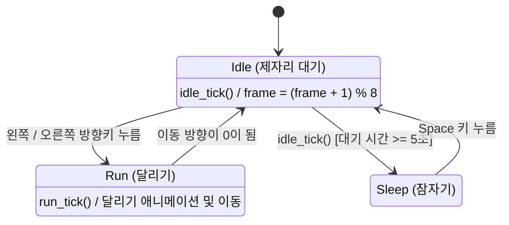

# 소년 상태 머신

`Boy.state_machine`은 `transitions.Machine`이며, 시작 상태는 `idle`이다.
`idle`에서 왼쪽 또는 오른쪽 방향키를 누르면 하나의 `run` 상태로 달린다.
방향은 `move_dir`과 `face_dir`로 구분하며, 방향키를 놓으면 `idle`로 돌아온다.
`idle`에서 5초 이상 머무르면 `sleep`으로 전환되고, 스페이스 키를 누르면 다시 `idle`로 돌아온다.



`main.py`에서 `Boy.update()`를 호출하면 `idle_tick()`이 발생한다.
대기 시간이 5초 미만이면 목적지가 `None`인 내부 전이로 Idle 상태를 유지하며
0~7번 애니메이션 프레임을 반복한다. 시작 위치는 `(400, 90)`이다.
그릴 때는 스프라이트 시트의 오른쪽 대기 행(`y=300`) 또는 왼쪽 대기 행(`y=200`)을 사용한다.
Run에서는 오른쪽 달리기 행(`y=100`) 또는 왼쪽 달리기 행(`y=0`)을 사용하며,
업데이트마다 이동 방향으로 5픽셀 이동한다. 소년의 중심 x좌표는 `50`부터 `화면 너비 - 50`으로
제한하여 100픽셀 너비의 스프라이트가 화면 밖으로 나가지 않게 한다.
누르고 있는 방향키는 집합으로 관리하여 키 반복 입력이 이동 속도에 영향을 주지 않는다.
양쪽 방향키를 함께 누르면 멈추고, 한쪽을 놓으면 남은 방향으로 달린다.
Sleep 상태에서는 첫 프레임을 90도 회전해 누운 모습으로 표시하고 애니메이션을 멈춘다.
`main.py`는 키 입력을 `Boy.handle_event()`에 전달한다. Sleep에서 스페이스 키를 누르면
Idle로 돌아오면서 프레임과 대기 타이머를 초기화한다. 대기 시간은 `time.monotonic()`으로 측정한다.
Run에서 Idle로 돌아올 때도 대기 타이머가 초기화된다. Sleep에서는 방향키 입력을 무시한다.

이 폴더에서 다음 명령으로 설치하고 `main.py`를 실행한다. `boy.py`는 클래스 정의 파일이다.

```powershell
python -m pip install -r requirements.txt
python main.py
```
